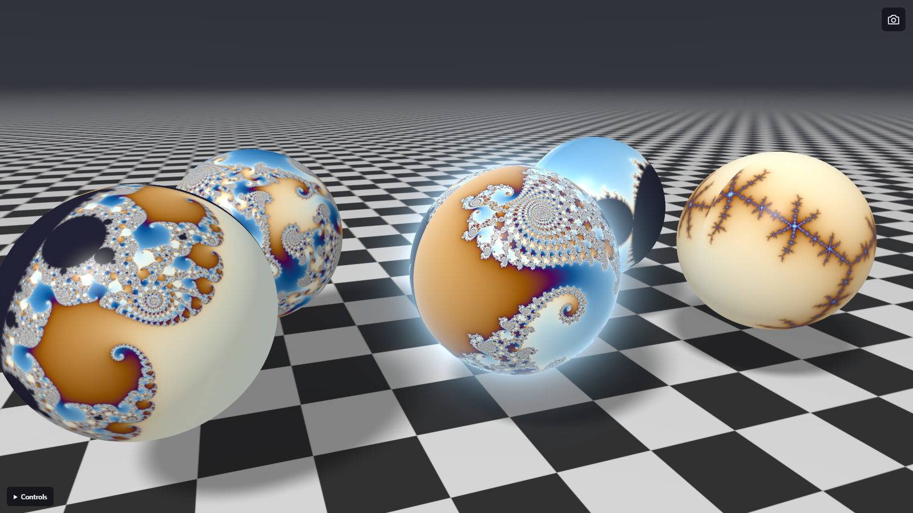

# Mandelbrot Sphere

A single-page WebGL2 toy that computes the Mandelbrot set on the GPU and maps it onto a sphere, identically on the western and eastern hemispheres, floating over a classic checkerboard floor.

**[Try it live](https://hwiguna.github.io/MandelbrotShader/)**

## Features

- **Per-pixel GPU fractal**: the sphere is ray-traced in a fragment shader and the Mandelbrot set is evaluated at each hit point, so detail stays sharp at any camera distance.
- **Two identical hemispheres**: each hemisphere is mapped onto its own disk with a stereographic projection, which preserves the fractal's shapes.
- **Deep zoom when needed**: plain 32-bit floats are used until they would start to pixelate, then it switches to perturbation against a double-precision reference orbit computed on the CPU. That allows zooms down to about 10⁻¹².
- **Snapshots**: the camera icon (top right) bakes the current fractal into a texture and places a copy of the sphere on the floor around the main one. Up to 16 are kept. The live sphere is the one with the glowing aura.
- **Color cycling** with adjustable speed.

## Controls

| Input | Camera | Fractal (hold **Ctrl**) |
|---|---|---|
| Left-drag | Orbit | Rotate around the screen center |
| Right-drag / Shift+drag | Pan | Pan |
| Wheel | Zoom | Zoom toward the cursor |

- **Tab**: toggle color cycling
- **↑ / ↓**: color cycle speed (go below zero to reverse)
- **Double-click**: reset the camera and fractal view
- **Camera icon**: take a snapshot

## Running locally

There's no build step and nothing to install. Open `index.html` in a browser that supports WebGL2 (any current Chrome, Edge or Firefox).
